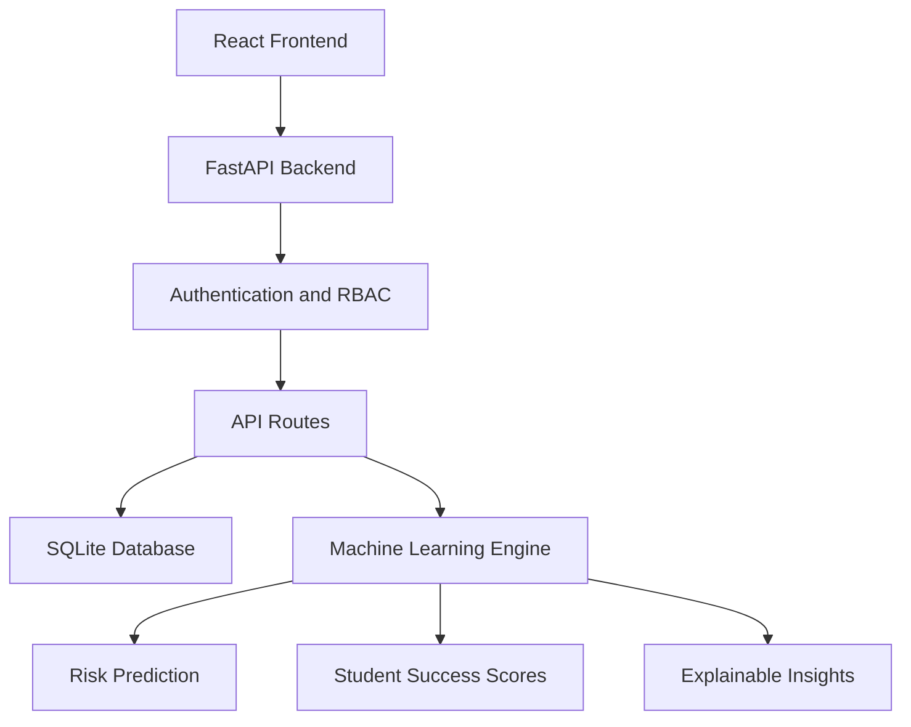

# CODEBUFFET — AI-Powered Student Analytics Platform

> **AI-Powered Student Analytics & Success Intelligence Platform**  
> Developed for Hackcelerate Challenge #04 (Student Analytics & Success Platform) in association with KPMG in India.

## Project Overview

CODEBUFFET is a full-stack, data-driven student success intelligence platform designed for higher education institutions. It analyzes academic performance, attendance, placement readiness, technical skills, LMS activity, and campus engagement to provide actionable insights.

## Key Features

- Campus Executive Dashboard with institutional KPIs and analytics.
- Student Directory with searchable student profiles.
- Faculty Mentor Dashboard with mentee tracking and interventions.
- Placement & Career Readiness Dashboard.
- Personal Student Cockpit with success scores and What-If simulation.
- Explainable academic and placement risk detection.
- Role-based authentication and authorization.
- Anti-IDOR security protection.
- CSV student data export.
- Machine learning-based placement risk prediction.

## Technology Stack

| Layer | Technologies |
|---|---|
| Frontend | React, Vite, React Router |
| Backend | Python, FastAPI, Uvicorn |
| Database | SQLite |
| Machine Learning | LightGBM, Scikit-learn |
| Data Processing | Pandas, NumPy |
| Visualization | Recharts |
| Authentication | JWT, PBKDF2-HMAC-SHA256 |
| Testing | Pytest |

## System Architecture



## Project Structure

```text
CODEBUFFET/
├── backend/
│   ├── main.py
│   ├── database.py
│   ├── auth.py
│   ├── routes/
│   └── scripts/
├── Frontend/
│   ├── src/
│   ├── public/
│   └── package.json
├── models/
├── tests/
├── docs/
├── kaggle.csv
├── ml_service.py
├── requirements.txt
└── README.md
```

## Prerequisites

- Python 3.10+
- Node.js 18+
- npm
- Git

Verify the installations:

```powershell
python --version
node --version
npm --version
git --version
```

## Installation and Setup

### 1. Clone the repository

```powershell
git clone https://github.com/balinenimounika/CODEBUFFET-AI-Student-Analytics.git
cd CODEBUFFET-AI-Student-Analytics
```

### 2. Backend setup

```powershell
python -m venv venv
.\venv\Scripts\Activate.ps1
python -m pip install -r requirements.txt
```

### 3. Environment configuration

Create a `.env` file using `.env.example` if available.

Configure your environment variables and use a secure secret key. Never commit real credentials or production secrets.

### 4. Initialize the database

```powershell
python -m backend.seed
```

### 5. Frontend setup

```powershell
cd Frontend
npm install
```

## Running the Project

Run the backend from the project root:

```powershell
python -m uvicorn backend.main:app --host 127.0.0.1 --port 8000 --reload
```

Run the frontend from the `Frontend` directory in another terminal:

```powershell
npm run dev
```

### Application URLs

- Frontend: `http://localhost:5173`
- Backend: `http://127.0.0.1:8000`
- Swagger API Documentation: `http://127.0.0.1:8000/docs`

## Database and Student Analytics

CODEBUFFET uses SQLite for persistent student records and analytics.

The platform supports:
- Student profile management.
- Academic performance analysis.
- Attendance monitoring.
- Placement readiness tracking.
- Department-wise analytics.
- Mentor allocation and intervention tracking.
- Benchmark cohort analysis.

## Machine Learning

The analytics engine provides:
- Student Success Score calculation.
- Academic risk detection.
- Placement risk prediction.
- Explainable risk factors.
- Personalized improvement insights.

## Testing

Run backend tests:

```powershell
python -m pytest tests/test_backend.py -v
```

Build the frontend:

```powershell
cd Frontend
npm run build
```

## Deployment

The application supports separate frontend and backend deployment.

- Frontend: Vercel, Netlify, or other static hosting platforms.
- Backend: Render or other Python-compatible hosting platforms.
- Database: SQLite with persistent storage configuration.

Configure production environment variables and CORS origins before deployment.

## Security

- Password hashing using PBKDF2-HMAC-SHA256.
- JWT-based authentication.
- Role-based access control.
- Anti-IDOR authorization checks.
- Environment-based secret management.

## Future Improvements

- Automated LMS integrations.
- Email and push notifications for attendance alerts.
- Resume parsing and skill extraction.
- Advanced ML model monitoring.
- Multi-institution support.

## Acknowledgments

- Hackcelerate Challenge #04.
- KPMG in India.
- Open-source technologies including React, FastAPI, SQLite, LightGBM, and Scikit-learn.

---

**CODEBUFFET — Turning Student Data into Student Success.**